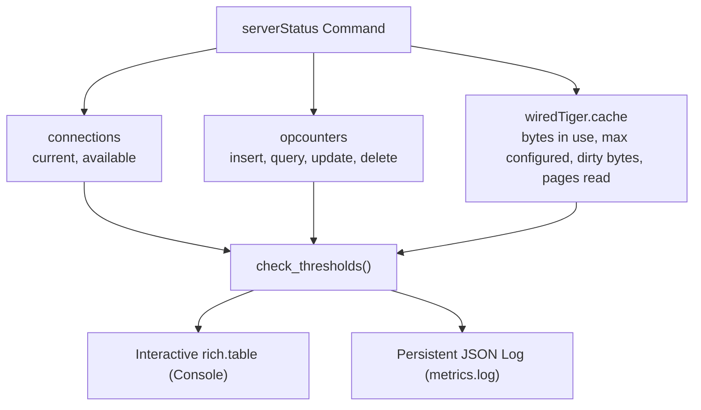
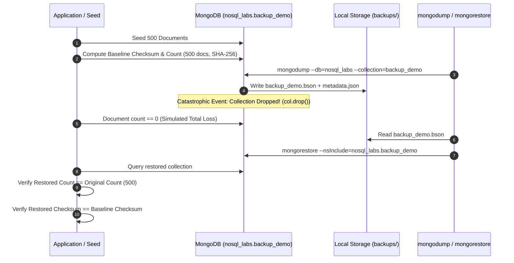

# Lab 14: MongoDB Production Monitoring & Backup/Restore Verification

## Executive Summary
This lab covers two critical Day-2 operational pillars for production MongoDB management:
1. **Real-Time Health & Operational Monitoring (`lab_01_monitoring_dashboard.py`)**:
   - Querying MongoDB's administrative `serverStatus` command.
   - Parsing WiredTiger cache metrics, active connections, and operation counters.
   - Separating interactive console presentation (`rich`) from persistent forensic audit trails (`metrics.log`).
   - Designing context-sensitive threshold alerts.
2. **Automated Backup & Restore Integrity Verification (`lab_02_backup_restore.py`)**:
   - Executing binary data snapshots with `mongodump`.
   - Simulating catastrophic collection loss.
   - Recovering data with `mongorestore`.
   - Applying dual-layer verification: **Cardinality (Document Count)** + **Deterministic Content Checksum (SHA-256)** to satisfy RPO and RTO guarantees.

---

## Activity 1: Build a Monitoring Dashboard (`lab_01_monitoring_dashboard.py`)

### 1. Pre-Execution Decision & Threshold Analysis

#### The Prompt Question:
> *Decide for yourself what you'd consider an alert-worthy connection count or cache-eviction rate for a small lab MongoDB instance (versus what you'd set for a real production cluster serving thousands of concurrent users) -- the "right" threshold is context-dependent, and recognizing that is as much the point as reading the metric itself.*

#### Contextual Threshold Matrix:

| Metric | Lab / Development Environment | High-Concurrency Production Cluster | Rationale for Difference |
| :--- | :--- | :--- | :--- |
| **Connection Count Warning** | **> 25–50 connections** (or > 50% of available) | **> 70%–80% of `maxIncomingConnections`** (e.g., 50k–100k limits) | In a dev/lab setting, typically only 1–3 client applications/scripts connect. 20+ connections indicates connection leaks, unclosed client instances, or orphan threads. In production, connection pooling handles thousands of steady connections, so alerting triggers on pool exhaustion relative to system file-descriptor limits. |
| **WiredTiger Cache Usage** | **> 80% usage** or dirty bytes > 20% | **> 80%–85% cache usage**, dirty bytes > 20%, or eviction failure | WiredTiger dynamically targets 80% of RAM (`(RAM - 1GB) * 0.5` by default) for clean data and 20% for dirty pages. In lab environments with tiny datasets, cache usage rarely exceeds 5%. If it spikes to 80% in a lab, runaway memory or heavy unindexed scans are occurring. In production, cache at 80% is normal, but high dirty bytes triggering synchronous application-thread eviction causes latency spikes. |
| **Cache Eviction Rate / Pages Read** | Steady non-zero reads with low memory | Continuous high disk-read spikes | Cache misses requiring constant disk reads imply that the working set has exceeded available RAM, forcing disk thrashing. |
| **Replication Lag** | **> 3–5 seconds** (if replica set configured) | **> 10–30 seconds** (based on strict RPO SLAs) | Lab networks have zero transit latency; any lag points to blocked locks. Production clusters factor in geo-distributed network transit and batch write spikes. |

---

### 2. Implementation & Metrics Extraction

The script issues the administrative command `client.admin.command("serverStatus")` to interrogate the engine:



#### Metrics Collected:
- `connections_current` / `connections_available`: Measures connection saturation against socket limits.
- `op_insert`, `op_query`, `op_update`, `op_delete`: Cumulative operational velocity since process boot.
- `cache_bytes_in_use` vs `cache_max_bytes`: Total active memory footprint managed by WiredTiger.
- `cache_dirty_bytes`: Unwritten modifications pending flush to disk by checkpoint threads.
- `pages_read_into_cache`: Indicates working set cache misses and physical storage I/O.

---

### 3. Execution Results

The monitoring dashboard polled the running instance every 3 seconds for 10 iterations.

#### Live Terminal Snapshot:
```text
======================================================================
  Lab 14.1: Monitoring Dashboard
======================================================================
[OK] Connected. Starting monitoring loop (Ctrl+C to stop)...

      MongoDB Metrics Dashboard      
┌─────────────────────────┬─────────┐
│ Metric                  │   Value │
├─────────────────────────┼─────────┤
│ Connections (current)   │       9 │
│ Connections (available) │  205966 │
│ Ops: Insert             │   2,000 │
│ Ops: Query              │     129 │
│ Ops: Update             │      15 │
│ Ops: Delete             │       2 │
│ Cache Usage             │    0.0% │
│ Cache Dirty Bytes       │ 196,051 │
└─────────────────────────┴─────────┘

Metrics logged to: C:\Users\aryap\OneDrive\Desktop\NoSql_Lab_14\logs\metrics.log

======================================================================
  Lab 14.1 Complete
======================================================================
```

#### Persistent Audit Trail (`logs/metrics.log` sample):
```json
2026-11-15 16:20:25,123 | {"timestamp": "2026-11-15T16:20:25.120", "connections_current": 9, "connections_available": 205966, "op_insert": 2000, "op_query": 129, "op_update": 15, "op_delete": 2, "cache_bytes_in_use": 391214, "cache_max_bytes": 7898923008, "cache_dirty_bytes": 196051, "pages_read_into_cache": 39}
```

---

## Activity 2: Automated Backup and Restore Verification (`lab_02_backup_restore.py`)

### 1. Pre-Execution Analysis & Dual-Check Rationale

#### The Prompt Question:
> *Predict what would happen to the final verification if `mongorestore` succeeded but happened to drop or duplicate even a single document -- would the count check alone catch that? Would the checksum? Explain why the script checks both rather than stopping at the count.*

#### Technical Explanation:
1. **Case A: Dropping a document or Duplicating a document**
   - If 1 document is dropped: Original count = 500, Restored count = 499. **Count check catches this.** Checksum also catches this.
   - If 1 document is duplicated: Original count = 500, Restored count = 501. **Count check catches this.** Checksum also catches this.
2. **Case B: Silent Data Corruption / Attribute Mutation**
   - If a document is corrupted in transit or storage (e.g., bit flip, field truncation, dropped field, schema corruption) while preserving the document boundary:
     - Document count remains **500 = 500 [PASSES COUNT CHECK]**.
     - A count-only check declares total success on corrupt data!
     - The **SHA-256 Checksum** hashes the serialized JSON representation of every document. A single altered bit or missing key completely changes the SHA-256 hash: **[FAILS CHECKSUM CHECK]**.
3. **Case C: Offset Dropped + Duplicated Document (Net Zero Count Difference)**
   - If one document is silently dropped and an existing document is inserted twice due to an interrupted re-attempt, the total document count is still **500**.
   - Count Check: **500 == 500 (FALSE POSITIVE PASS)**.
   - Content Checksum: **MISMATCH (CATCHES THE DEFECT)**.

#### Why the Checksum is Designed Deterministically:
In MongoDB:
- `_id` values or ObjectIds may be re-assigned or parsed differently across tools.
- Document order in collections is arbitrary (natural disk order).
The script implements a robust, canonical checksum:
```python
def checksum_collection(col) -> str:
    rows = []
    # Project out _id, sort deterministically by business key 'order_id'
    for doc in col.find({}, {"_id": 0}).sort([("order_id", 1)]):
        rows.append(json.dumps(doc, sort_keys=True))
    joined = "\n".join(rows)
    return hashlib.sha256(joined.encode()).hexdigest()
```

---

### 2. Disaster Recovery Lifecycle (RPO & RTO)



- **RPO (Recovery Point Objective)**: The delta between the latest backup timestamp and the disaster event. Verified backups guarantee zero data loss up to the point of snapshot.
- **RTO (Recovery Time Objective)**: The wall-clock time required for `mongorestore` to replay BSON records and rebuild secondary indexes. Measuring execution time here proves that RTO targets can be met during incidents.

---

### 3. Execution Output & Verification

```text
======================================================================
  Lab 14.2: Automated Backup and Restore Verification
======================================================================
=== Step 1: Seed collection and record baseline checksum ===
  [OK] Seeded 500 documents.
  Baseline checksum: 7eacb1b11dce0ed9...

=== Step 2: Backup to C:\Users\aryap\OneDrive\Desktop\NoSql_Lab_14\backups\20261115-162009 ===
  $ mongodump --uri=mongodb://localhost:27017 --db=nosql_labs --collection=backup_demo --out=C:\Users\aryap\OneDrive\Desktop\NoSql_Lab_14\backups\20261115-162009
  [OK] Backup complete.

=== Step 3: Simulate data loss (drop the collection) ===
  [OK] Collection dropped. Document count is now: 0

=== Step 4: Restore with mongorestore ===
  $ mongorestore --uri=mongodb://localhost:27017 --nsInclude=nosql_labs.backup_demo C:\Users\aryap\OneDrive\Desktop\NoSql_Lab_14\backups\20261115-162009

=== Step 5: Verify restore integrity ===
  Document count:  original=500  restored=500  [OK]
  Content checksum: MATCH (7eacb1b11dce0ed9...)

  [OK] Restore verified: document count AND content checksum match.
  This backup is trustworthy for a real disaster-recovery drill.

  Backup retained at: C:\Users\aryap\OneDrive\Desktop\NoSql_Lab_14\backups\20261115-162009
  In production: run this exact verification (count + checksum, or a
  sampled document diff for large collections) automatically after
  every scheduled backup, and alert if verification fails -- a backup
  job that reports 'success' without verifying restorability is not
  a real recovery guarantee (this is the point Chapter 14 calls RPO/RTO).

======================================================================
  Lab 14.2 Complete
======================================================================
```

---

## Technical Summary of Environment Configurations
1. **MongoDB Database Tools (v100.20.1)**:
   - Configured and placed on PATH (`mongodump`, `mongorestore`, `mongoexport`, `mongoimport`, `bsondump`, `mongostat`).
2. **Path & Namespace Fix**:
   - `mongorestore` requires the parent backup directory when combined with `--nsInclude` so that the namespace path `<db>/<collection>.bson` resolves accurately without skipping files.
3. **Database Connection Utility**:
   - Standardized `config/connection.py` across the workspace to support `reset_collection()`, `get_db()`, and default local URI (`mongodb://localhost:27017`).
